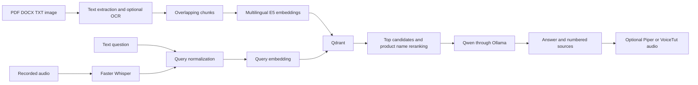

# Multimodal RAG Intelligent Assistant

A local Arabic/English knowledge assistant that combines document ingestion, multilingual retrieval, source-cited language-model responses, speech recognition, and optional synthesized speech. The original proof of concept used Telecom Egypt product information. This repository packages the implementation with a small fictional corpus for demonstration.

## Architecture



The retrieval layer uses normalized E5 vectors, cosine search, and an exact product-name bonus when the query mentions one of the original telecom products. The generator receives retrieved text and citation metadata. User documents retain filenames and PDF page numbers where available. Image uploads and scanned PDF pages use Tesseract OCR. GPU selection includes hardware checks and CPU fallback for embeddings and ASR.

## Quick start

Use Python 3.11 and run commands from the repository root. The example shell is PowerShell. On Linux or macOS activate the environment with `source .venv/bin/activate`.

```powershell
python -m venv .venv
.\.venv\Scripts\Activate.ps1
python -m pip install --upgrade pip
# Install the appropriate CPU or CUDA PyTorch build using its official selector.
python -m pip install -r requirements.txt
Copy-Item .env.example .env
```

Install [Ollama](https://ollama.com/download) and start its local service. Fetch the model named in `.env`.

```powershell
ollama pull qwen3:4b
```

Run a local Qdrant service. Docker is one option. This binding exposes the service on localhost and stores its data in a named volume.

```powershell
docker run -d --name multimodal-rag-qdrant -p 127.0.0.1:6333:6333 -v multimodal-rag-qdrant:/qdrant/storage qdrant/qdrant:v1.13.6
python -m ingestion.index_te_chunks
python -m streamlit run app/streamlit_app.py
```

The index command loads four original fictional chunks from `samples/synthetic_chunks.json`. It creates `multimodal_rag_demo` and upserts stable IDs. `--reset` explicitly deletes and recreates the configured collection. Keep a dedicated collection for this demo. Changing the embedding model requires a fresh collection and a matching vector dimension in `retrieval/vector_store.py`, currently 384.

First use downloads the public `intfloat/multilingual-e5-small` embedding model to the Hugging Face cache. After provisioning all models, set `HF_LOCAL_FILES_ONLY=true` for cached-model use. The application talks to the configured Ollama, Qdrant, and optional VoiceTut services. All can run locally. The first-use downloads require internet access.

Try these questions, then upload `samples/demo_upload.txt` to try document citations.

- How can I contact the demo support team?
- إزاي أتواصل مع فريق دعم التجربة؟
- What document formats can I upload in this demonstration?

The sample facts are fictional and include an `example.invalid` address.

## OCR and voice

Text PDF, DOCX, and TXT uploads use Python parsers. For images or scanned PDFs, install the native [Tesseract executable](https://tesseract-ocr.github.io/tessdoc/Installation.html) and the Arabic `ara` and English `eng` language data. Set `TESSERACT_CMD` if the executable is absent from `PATH`. PDF page rasterization uses PDFium through `pypdfium2`.

Install the optional speech packages when using recording or Piper output.

```powershell
python -m pip install -r requirements-voice.txt
```

Faster-Whisper loads the multilingual `small` model on first transcription. CPU uses int8. CUDA use additionally depends on CTranslate2-compatible CUDA/cuDNN libraries, driver support, and available memory. Follow [Faster-Whisper's runtime requirements](https://github.com/SYSTRAN/faster-whisper#requirements).

Piper needs the separately downloaded `ar_JO-kareem-medium.onnx` and its matching `.onnx.json`, placed under `voice/models/` or selected with `PIPER_MODEL`. Fetch them through the [Piper voices repository](https://huggingface.co/rhasspy/piper-voices/tree/main/ar/ar_JO/kareem/medium) and check that voice's model card and license. The supplied Piper integration uses the `PiperVoice`/`SynthesisConfig` API. TTS defaults to **None** in the UI.

The original VoiceTut adapter and FastAPI service remain in `voice/` as an optional experimental integration. They require a separate environment containing `voicetut_tts`, FastAPI, Uvicorn, the model files expected by that package under `voice/models/voicetut`, and its additional upstream dependencies. Start it with `python -m voice.voicetut_server` after installing those components. `VOICETUT_URL` defaults to localhost port 8001. Its environment was unavailable during preparation, so use the text or Piper path for the initial setup.

## Evaluation

```powershell
python -m evaluation.run_retrieval_benchmark
python -m unittest discover -s tests -v
```

The runnable retrieval cases target the fictional sample corpus. They check a nonempty result, a vector-score threshold, and expected text in the first retrieved payload. Evaluate answer and citation correctness, ASR word error rate, OCR quality, and end-to-end latency separately.

`evaluation/historical_retrieval_benchmark_results.md` preserves the original saved result of 8/8 retrieval checks, mean top-1 score 0.8779, and mean retrieval time 0.031 s. These historical retrieval measurements belong to the original Telecom Egypt corpus and development environment. Original cases are retained as `historical_retrieval_cases.json`. Reproduction requires the original corpus. The fictional corpus has separate cases and has not yet been benchmarked with live models.

Validation includes syntax checks and five offline tests covering retrieval reranking, empty retrieval, document citation metadata, the generation HTTP request, and the sample schema. A full run with Qdrant, Ollama, embeddings, OCR, and voice remains pending. Dependency ranges require resolution and a lockfile on the target CPU/CUDA environment. Reference APIs and available releases are documented by [Streamlit](https://pypi.org/project/streamlit/1.50.0/), [Sentence Transformers](https://pypi.org/project/sentence-transformers/3.4.1/), [Qdrant client](https://pypi.org/project/qdrant-client/1.13.2/), [Piper](https://pypi.org/project/piper-tts/1.3.0/), and [Ollama](https://ollama.com/library/qwen3:4b).

## Project structure

```text
app/          Streamlit chat, uploads, recording, source display
config/       Environment settings and hardware checks
ingestion/    Document OCR, chunking, indexing, optional original web pipeline
retrieval/    E5 embeddings and Qdrant helpers
generation/   Query normalization, reranking, context and answer generation
voice/        ASR, Piper, optional VoiceTut client and service
samples/      Tiny fictional corpus and upload example
evaluation/   Synthetic cases and separately labeled historical evidence
tests/        Lightweight offline behavioral checks
```

## Extending the corpus

For a document, use the upload UI or `python -m ingestion.user_documents path/to/file.pdf`. Uploads are stored in the configured vector collection and replacing the same display filename replaces its earlier indexed chunks. This is a single-user local demonstration. Collection names do not provide per-user access isolation.

The original website discovery, rendering, cleaning, and chunking scripts are retained as optional ingestion research code. Install `requirements-ingestion.txt` and run `python -m playwright install chromium` before using browser-based collection. Their working data is stored under `ingestion/data/`. Run them as modules from the project root and supply only content you may use. The scripts need a fresh collection run and are separate from the fictional quick-start corpus.

The application retains domain-specific normalization/reranking rules from the original telecom demonstration. Adapt these rules and the prompt for a different subject. The single-user prototype still needs authentication, adversarial document evaluation, answer-quality checks, and operational monitoring before a shared deployment.

## Attribution and licensing

The original implementation is Khaled Ezzat's project, assembled here from its maintained Python modules. E5, Qwen, Whisper, Piper, Qdrant, Streamlit, Tesseract, and VoiceTut remain third-party dependencies with their own licenses and model terms. The author must choose a project license before granting reuse rights. No license is assigned by this preparation step.
